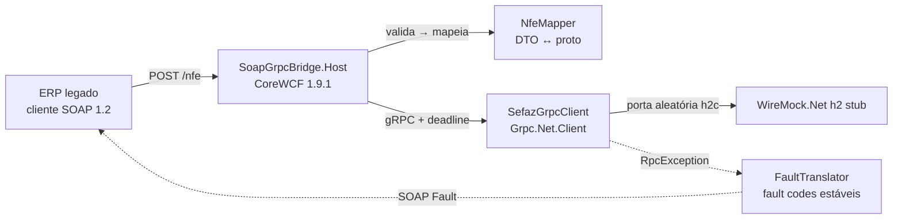

# soap-grpc-bridge

[](https://github.com/TiagoR85/soap-grpc-bridge/actions/workflows/ci.yml)
[](https://github.com/TiagoR85/soap-grpc-bridge/releases)
[](LICENSE)

SOAP 1.2 → gRPC bridge for legacy ERP integrations: a **CoreWCF** endpoint (`?wsdl`, document/literal, SOAP 1.2) that validates requests, maps them to protobuf and forwards them to a modern gRPC "SEFAZ" backend — with gRPC failures translated into **stable SOAP Fault codes** (`SEFAZ:BackendUnavailable`, `SEFAZ:Timeout`, `SEFAZ:IntegrityError`, `SEFAZ:InvalidRequest`). The 4+2 integration matrix runs over the wire (real Kestrel port + `System.ServiceModel.ChannelFactory`) against a local WireMock.Net HTTP/2 stub. Fully offline.



## The 6 scenarios

| Operation | Success | Backend down | Timeout | Integrity |
|---|---|---|---|---|
| `AutorizarNfe` | `nRec`+`nProt`/`cStat 100` | porta morta → `SEFAZ:BackendUnavailable` (Server) | stub 3s > deadline 1s → `SEFAZ:Timeout` (Server) | resposta sem `nProt` → `SEFAZ:IntegrityError` (Server) |
| `ConsultarStatusServico` | `cStat 107` operacional | porta morta → `SEFAZ:BackendUnavailable` | — | — |

Plus: invalid input (lote vazio / `cUF` inválido) → `SEFAZ:InvalidRequest` (Client), and a WSDL test asserting both operations are published. Business rejections (`cStat`≠100) travel as normal responses — never as faults.

## Running the tests

Requires the .NET 10 SDK. No Docker, no network:

```bash
git clone https://github.com/TiagoR85/soap-grpc-bridge.git
cd soap-grpc-bridge
dotnet test SoapGrpcBridge.Tests -p:CollectCoverage=false   # fast loop (~seconds)
dotnet test SoapGrpcBridge.Tests                             # CI gate (coverage >= 80% line, Host only)
```

## Quickstart

```bash
dotnet test SoapGrpcBridge.Tests -p:CollectCoverage=false    # the full 4+2 matrix doubles as the demo
dotnet run --project SoapGrpcBridge.Host                     # bridge on http://localhost:5000
curl "http://localhost:5000/nfe?wsdl"                        # WSDL with both operations
```

Point the bridge at any gRPC backend implementing `SoapGrpcBridge.Contracts/Protos/sefaz_nfe.proto`:

```bash
# PowerShell
$env:Sefaz__GrpcUrl = "http://localhost:9090"
$env:Sefaz__DeadlineSeconds = "5"
dotnet run --project SoapGrpcBridge.Host
```

Defaults live in `appsettings.json`; see `.env.example` (placeholders only).

## How it works

- **Wire-real tests in-process**: `WebApplicationFactory<Program>` + `WithWebHostBuilder(builder => builder.UseUrls($"http://127.0.0.1:{FreePort.Get()}"))` + `factory.UseKestrel()` runs the host on a real dynamic Kestrel port so a genuine `ChannelFactory` SOAP client talks to it — see [ADR-0003](docs/adr/ADR-0003-test-topology.md).
- **Stable fault contract**: every gRPC failure is classified once in `FaultTranslator`; fault codes are asserted by string, never by message text — see [ADR-0002](docs/adr/ADR-0002-grpc-to-soap-fault-mapping.md).
- **CoreWCF over SoapCore**: full SOAP 1.2 + WSDL support on .NET 10 with the WCF programming model the market expects — see [ADR-0001](docs/adr/ADR-0001-corewcf-soap-server.md).
- **Coverage gate**: Coverlet excludes `Tests` and generated `Contracts` namespaces — the 80% line gate measures `SoapGrpcBridge.Host` only.

## Decisions

- [ADR-0001](docs/adr/ADR-0001-corewcf-soap-server.md) — CoreWCF vs SoapCore for the SOAP 1.2 server
- [ADR-0002](docs/adr/ADR-0002-grpc-to-soap-fault-mapping.md) — gRPC status → SOAP Fault mapping with stable `SEFAZ:*` codes
- [ADR-0003](docs/adr/ADR-0003-test-topology.md) — WebApplicationFactory + Kestrel + WireMock.Net HTTP/2 test topology

## Scope

Implemented: SOAP 1.2 endpoint with auto WSDL · request validation (27 UF codes) · DTO↔protobuf mapper · gRPC client with configurable deadline · stable fault mapping · 4+2 wire matrix · coverage-gated CI.

Backlog (YAGNI): auth/signing of envelopes · TLS between bridge and backend · retry/circuit-breaker (the ERP owns retries) · persistence · more NFe operations (evento, consulta de protocolo) · NuGet publication.

## About this repository

This repository is part of a personal study project (the "github-portfolio-dotnet" portfolio). It was built with heavy use of AI-assisted development tools, but it is held to production standards on purpose: automated tests with a coverage gate, CI on every push, architecture decision records, and honest documentation of trade-offs. It is not affiliated with any employer or client.

## License

MIT — see [LICENSE](LICENSE).